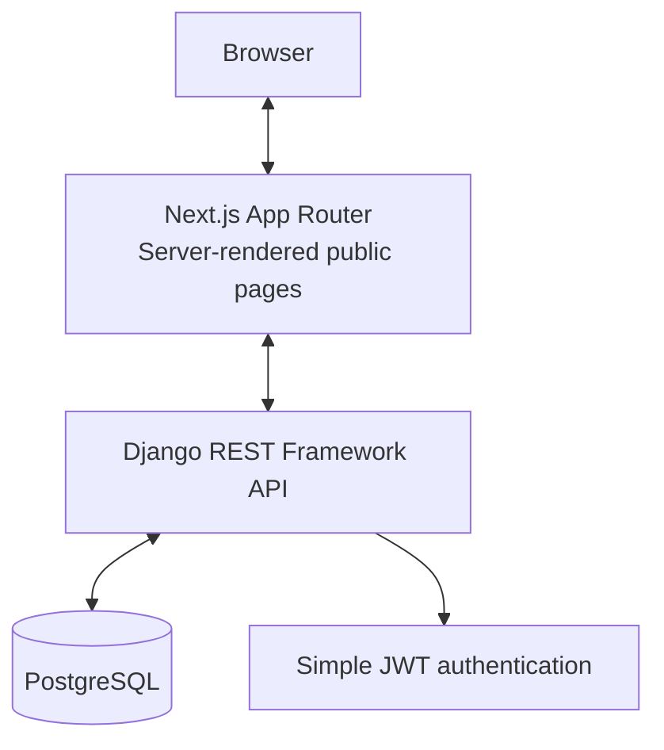

# Architecture and ERD

The public homepage and course catalogue are rendered by Next.js server components. The admission form and authenticated dashboards use client interactions for submissions and refreshes, with data served by Django REST Framework. Production deployment must set a strong secret, HTTPS, exact allowed hosts/origins, and a hosted PostgreSQL URL. Do not use SQLite for production.

See `erd.mmd` for the logical relational diagram. Django's migration system is the source of truth for the actual database schema; generate migrations after installing requirements with `python manage.py makemigrations academy` and apply them using `python manage.py migrate`.
